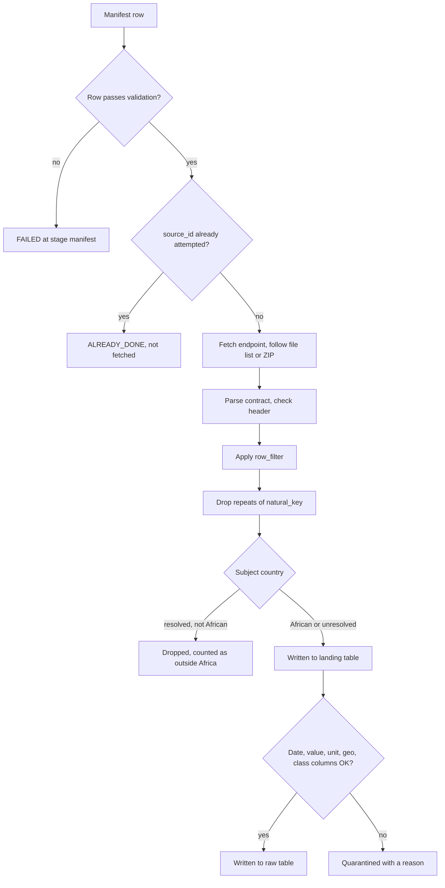

# Writing an ingestion manifest

This guide is for anyone adding a dataset to the weekly ingestion engine. It covers what a manifest row is, how to build one from a publisher's dataset, how to test it on your machine, and what every column means.

The loader in [`src/ingestion_engine/manifest.py`](src/ingestion_engine/manifest.py) is the source of truth. If this guide and the code disagree, the code wins. Fix the guide.

Contents:

1. [How the engine reads a manifest](#1-how-the-engine-reads-a-manifest)
2. [Before you start: what to find out about the source](#2-before-you-start-what-to-find-out-about-the-source)
3. [Worked example: HarvestStat yield](#3-worked-example-harveststat-yield)
4. [Step by step for a new source](#4-step-by-step-for-a-new-source)
5. [Recipes by source type](#5-recipes-by-source-type)
6. [Field reference](#6-field-reference)
7. [Testing a manifest locally](#7-testing-a-manifest-locally)
8. [Reading the results](#8-reading-the-results)
9. [Re-running a source](#9-re-running-a-source)
10. [Pitfalls](#10-pitfalls)
11. [Error messages and fixes](#11-error-messages-and-fixes)
12. [Checklist before you enable a row](#12-checklist-before-you-enable-a-row)

---

## 1. How the engine reads a manifest

A manifest is a CSV file in [`manifests/`](manifests/). The job reads every `*.csv` in that folder. Each row in a manifest is one **source**, and each source becomes one BigQuery table.

The row is a declared contract. You tell the engine the file type, the exact columns, which column is the country, which is the date, which is the value, and so on. The engine does not inspect the file and guess. If the file does not match what you declared, the source fails or its rows are quarantined. This is deliberate ([ADR 0004](../docs/adr/0004-manifest-contract-is-declared.md)): a wrong guess that loads silently is worse than a clear failure.

What happens to one enabled row:



Two BigQuery datasets receive the data:

- **Landing** (`landing_dev` by default) gets the publisher's columns as reported, plus lineage columns. Every African or unresolved row lands here, including rows that later fail the checks.
- **Raw** (`raw_dev`, paired with `landing_dev`) gets only the rows that passed every check. It has the publisher's columns plus standard columns the engine fills in (`country_iso3`, `observation_date`, `year`, `value_num`, `unit`, and so on).

Both tables have the name you put in `table_name`.

---

## 2. Before you start: what to find out about the source

Open the dataset and answer these before you write anything. Every answer maps to one or more manifest columns.

| Question | Manifest columns |
| --- | --- |
| What URL returns the data itself, not the landing page? | `endpoint`, `source_url` |
| Is it a CSV, Excel workbook, JSON API, or HTML table? Is it inside a ZIP or a Dataverse/Zenodo record? | `contract_type`, `file_name` |
| What is the exact header row, in order? | `column_names`, `column_count` |
| Which sheet, and on which row is the header? | `sheet_name`, `header_row` |
| Does one file contain several measures (yield, production, area)? | one row per measure |
| Which column says which country the row is about? Is it a name, ISO2, or ISO3 code? | `geo_country_column`, `geo_code_standard` |
| How fine is the geography: country, region, district, market, GPS point? | `geo_grain` and the matching `geo_*_column` |
| Which column is the date, and how is it written? | `temporal_column`, `temporal_format`, `temporal_grain` |
| Which column is the number you want? | `value_column` |
| What unit is it in? Is the unit a column or fixed? | `unit_column` or `unit_constant` |
| Which columns describe what is measured (crop, commodity, currency)? | `class_columns` |
| Which columns together identify one observation? | `natural_key` |
| Which rows do you not want? | `row_filter` |
| Does it need an API key or login? | `auth_*` |
| Is it paginated? | `pagination` and related |

If you cannot answer one of these, the row is not ready to enable. Leave it with `enabled=false` and write what you know.

---

## 3. Worked example: HarvestStat yield

HarvestStat Africa publishes one CSV with yield, production, and area for every crop, district, and season. We want three tables, one per measure. Here is the yield row from [`gardian_african_datasets_augmented (1).csv`](<manifests/gardian_african_datasets_augmented (1).csv>), field by field.

**Identify the source**

- `source_id` = `harveststat_africa_1`
- `source_name` = `HarvestStat Africa Harmonized subnational crop statistics`
- `source_url` = `https://github.com/HarvestStat/HarvestStat-Africa` (the page a person reads)
- `endpoint` = `https://raw.githubusercontent.com/HarvestStat/HarvestStat-Africa/main/public/hvstat_africa_data_v1.2.csv` (the raw file the job downloads)
- `table_name` = `harveststat_africa_yield`
- `owner` = `ChidiOkoene`

**Declare the file**

- `contract_type` = `csv`. The endpoint returns the CSV directly.
- `file_name` is blank. There is no ZIP or catalog to look inside.
- `column_names` = `fnid,country,country_code,admin_1,admin_2,product,season_name,planting_year,planting_month,harvest_year,harvest_month,crop_production_system,qc_flag,area,production,yield`. This is copied from the first line of the file, every column, in order.
- `column_count` = `16`

**Say what each row is about**

- `indicator_class` = `PROD` (agricultural production)
- `geo_grain` = `admin2`, because each row is a district.
- `geo_country_column` = `country`, with `geo_code_standard` = `name` because the column holds names like `Kenya`.
- `geo_admin1_column` = `admin_1`, `geo_admin2_column` = `admin_2`. Both are required for `admin2`.
- `temporal_grain` = `year`, `temporal_column` = `harvest_year`, `temporal_format` = `%Y`.
- `value_column` = `yield`
- `unit_constant` = `mt/ha`. The file has no unit column, so we state it.
- `class_columns` = `product`, which is the crop. A row with no crop is quarantined.
- `measure_kind` = `yield`. Required for `PROD`.

**Say how to load it**

- `natural_key` = `fnid,product,harvest_year`. A district, a crop, and a year identify one observation.
- `load_mode` = `replace_table`. Each run replaces the table with the current file.
- `auth_required` = `false`, `auth_type` = `none`, `auth_ref` blank. The file is public.
- `enabled` = `true`

The production and area rows (`harveststat_africa_2`, `harveststat_africa_3`) are copies of this row with a different `source_id`, `table_name`, `value_column`, `unit_constant`, and `measure_kind`.

---

## 4. Step by step for a new source

### Step 1: Pick the manifest file

Add to an existing manifest if the source belongs to that collection. Otherwise create a new CSV in `manifests/`. Name it after the collection, for example `fao_giews.csv`. The file name is recorded on every row as `_manifest_file`, so a clear name helps later.

Start from this header. Column order does not matter to the loader, but keeping this order makes rows easier to compare across files. The first 23 columns must be present in every manifest. The rest are optional and may be left out entirely if no row in the file uses them.

```text
source_id,source_name,source_url,endpoint,table_name,indicator_class,contract_type,column_count,column_names,geo_grain,geo_country_column,geo_code_standard,temporal_grain,temporal_column,temporal_format,value_column,load_mode,natural_key,enabled,owner,auth_required,auth_type,auth_ref,geo_country_constant,geo_country_columns,geo_admin1_column,geo_admin2_column,geo_market_column,geo_lat_column,geo_lon_column,class_columns,measure_kind,unit_column,unit_constant,freshness_days,file_name,row_filter,sheet_name,header_row,xlsx_layout,html_table_selector,records_path,pagination,page_param,page_size,size_param,next_path,query,record_layout,auth_header,auth_query_param
```

Edit manifests in a text editor or VS Code, not Excel. Excel rewrites quoting, changes the encoding, turns `2020-01` into a date, and drops leading zeros. If you must use a spreadsheet, export as **CSV UTF-8** and check the diff before you commit.

### Step 2: Get the real download URL

`endpoint` must be the URL that returns the data bytes, and it must start with `https://`. Paste it into a browser or run `curl -I <url>` and check that you get the file, not an HTML landing page. A page that needs a click, a cookie, or a login form cannot be fetched.

Also check that the URL works before you enable the row. An endpoint that returns an HTTP error, redirects to plain `http://`, or exceeds the size limit currently stops the whole run rather than failing just that source.

### Step 3: Choose the contract

`contract_type` describes the table the engine will parse, after any catalog or ZIP step.

| The endpoint returns | `contract_type` | `file_name` |
| --- | --- | --- |
| A CSV file | `csv` | blank |
| An `.xlsx` workbook | `xlsx` | blank |
| An `.xls` workbook | `xls` | blank |
| A ZIP with exactly one CSV or workbook inside | the type of that file | blank, or the file name |
| A ZIP with several files | the type of the file you want | the file name inside the ZIP |
| A Dataverse dataset API response | the type of the file you want | the file name as Dataverse lists it |
| A Zenodo record API response | the type of the file you want | the file `key` |
| JSON records from an API | `json_api` | not used |
| An HTML page with a `<table>` | `html_table` | not used |

### Step 4: Copy the header exactly

Download the file and copy the header row into `column_names`, comma-separated, in the same order, with the same spelling, case, spaces, and punctuation. Then count them and put the number in `column_count`.

- For `csv`, `xlsx`, `xls`, and `html_table`, the parsed header must equal `column_names` exactly. List every column in the file, not just the ones you need. One extra, missing, renamed, or reordered column fails the whole source with `header mismatch`.
- For `json_api`, each object must have every listed key. Extra keys in the response are ignored. An object missing a key is quarantined.

Wrap `column_names` in double quotes in the CSV, because it contains commas:

```text
...,16,"fnid,country,country_code,admin_1,...",...
```

### Step 5: Split by measure

One row produces one table with one value column. If the file has several measures you want (yield, production, area), add one row per measure. Copy the row and change `source_id`, `table_name`, `value_column`, the unit, and `measure_kind`. Give every row its own `table_name`. Two rows that write to the same table with `replace_table` overwrite each other.

### Step 6: Fill geography, time, value, unit, and classes

Use the field reference in [section 6](#6-field-reference). Every column you name in these fields must appear in `column_names`.

### Step 7: Choose the natural key

`natural_key` lists the columns that together identify one observation. The engine keeps the first row for each key and silently drops later rows with the same key. A key that is too short loses data without any error. To check a key, load the file in pandas and run `df.duplicated(subset=[...]).sum()`. The result should be 0.

### Step 8: Set auth

Public sources: `auth_required=false`, `auth_type=none`, `auth_ref` blank. For gated sources, see [Gated API](#gated-api).

### Step 9: Test locally

Follow [section 7](#7-testing-a-manifest-locally). Only set `enabled=true` once the local run shows the source as `LOADED`, or as `PARTIAL` with quarantine reasons you understand and accept.

### Step 10: Open a PR

Commit the manifest change. Fill in the [checklist](#12-checklist-before-you-enable-a-row) in the PR description. The weekly cron (Sunday 02:00 UTC on Railway) picks up new `source_id`s on its next run.

---

## 5. Recipes by source type

### Direct CSV

The endpoint returns the CSV. Leave `file_name` blank.

The CSV reader handles these publisher quirks for you:

- a UTF-8 byte-order mark
- Windows-1252 text, such as files with a `µ` sign
- a second line starting with `#`, which is an HDX HXL tag row and is dropped
- a blank first header cell, as written by pandas `to_csv` with an index, which is dropped along with that column
- lines where the whole row was wrapped in one quoted field
- blank lines

Anything else, such as a title line above the header or a `;` delimiter, is not handled. The header check will fail.

Example: `harveststat_africa_1`, `ng_wfp_prices` in [`sources.example.csv`](manifests/sources.example.csv).

### Excel workbook (`xlsx` or `xls`)

- `sheet_name` picks the sheet. Blank uses the first sheet. The name must match exactly, including spaces.
- `header_row` is the zero-based row of the header. Use it when the publisher puts a title or notes above the table. If the header is on Excel row 4, set `header_row=3`.
- Rows that are completely blank are skipped.
- Cell values become text. A year typed as a number reads as `2020`. A year stored as a decimal reads as `2020.0` and will not parse with `%Y`.

### ZIP archive

If the endpoint returns a ZIP, the engine opens it.

- With one CSV or workbook inside, leave `file_name` blank, or name the file to be explicit.
- With several, set `file_name` to the file's name inside the ZIP. Use the bare name without folders: `GROW-Africa_Regional.xlsx`, not `data/GROW-Africa_Regional.xlsx`. The name must be unique in the archive.

Example: the nine `grow_africa_*` rows share one Zenodo ZIP (`.../files/GROW-Africa-Database.zip/content`) and each picks a workbook with `file_name`.

### Dataverse dataset

Point `endpoint` at the dataset API, not the HTML page:

```text
https://dataverse.harvard.edu/api/datasets/:persistentId/?persistentId=doi:10.7910/DVN/C3YBNN
```

Open that URL in a browser. Under `data.latestVersion.files`, find the file you want and copy `dataFile.filename` exactly into `file_name`. The engine downloads that file from the same Dataverse host.

Example: `era_crop_yield_treatment` uses `file_name=01a. ERA_Compiled_2025.csv`.

### Zenodo record

The engine can read a Zenodo record API response (`https://zenodo.org/api/records/<id>`) and pick the file whose `key` equals `file_name`. When you know the file you want, the direct content URL is simpler and is what the GROW-Africa rows use:

```text
https://zenodo.org/api/records/16544448/files/GROW-Africa-Database.zip/content
```

### One file, several measures

Add one row per measure. Copy everything and change `source_id`, `table_name`, `value_column`, `unit_constant` or `unit_column`, and `measure_kind`.

Examples: `harveststat_africa_1/2/3`, and the `grow_africa_*_yield/_production/_area` rows.

### One file, a subset of rows

Use `row_filter` to keep only rows whose cells match. Rows that do not match are dropped before landing and do not count as quarantined.

```text
Outcode=101                         one column, one value
Product=Maize|Rice                  one column, either value
Outcode=101&Product=Maize|Rice      both conditions
```

Matching is exact text after trimming spaces. `maize` does not match `Maize`.

Example: the ERA rows keep only `Outcode=101` (crop yield outcomes), and use `MeanT` (treatment) and `MeanC` (control) as two separate tables.

### JSON API

- `contract_type=json_api`
- `records_path` is the dot path to the list of records in the response, such as `data` or `result.items`. Blank means the response itself is the list. A single object at that path is treated as one record.
- `column_names` lists the keys to keep. Each record must be a flat object. A nested value is stored as its text form.
- `query` adds fixed query parameters, written as `key=value&key2=value2`. Example: `DATABASE_ID=WB_HCP`.

Pagination:

| API style | Settings |
| --- | --- |
| One response holds everything | `pagination=none` or blank |
| `?page=1`, `?page=2`, ... | `pagination=page`, `page_param=page`, `page_size=<n>`, and `size_param` if the API takes a page-size parameter |
| `?offset=0`, `?offset=1000`, ... | `pagination=offset`, `page_param=offset`, `page_size=1000`, `size_param=limit` |
| The response contains the next page URL | `pagination=next_link`, `next_path=<dot path to the URL>` (blank means `next`) |

Page mode starts at 1 and adds 1 each time. Offset mode starts at 0 and adds the number of records returned. Both stop when a page is empty or has fewer records than `page_size`. A next link must be HTTPS on the same host as `endpoint`.

Examples: `wb_rtfp` (offset with `limit`) and `wb_hcp` (offset with `skip` and `top`) in [`sources.example.csv`](manifests/sources.example.csv).

### HTML table

- `contract_type=html_table`
- `html_table_selector` is the zero-based index of the table on the page. Blank means the first table. Tables nested inside other tables are not counted.
- The first row of the table is the header.

### Gated API

Never put a key or password in the manifest. Put the name of an environment variable in `auth_ref`, and set that variable in your local `.env` and on the Railway service.

| `auth_type` | What is sent | Also set |
| --- | --- | --- |
| `api_key_header` | header `<auth_header>: <secret>` | `auth_header`, for example `X-API-Key` |
| `api_key_query` | query parameter `<auth_query_param>=<secret>` | `auth_query_param`, for example `api_key` |
| `bearer` | `Authorization: Bearer <secret>` | nothing |
| `basic` | `Authorization: Basic <base64 of secret>` | store the secret as `user:password` |

Set `auth_required=true`. If the variable is missing at run time, the source fails with `AUTH_MISSING`.

### Special layouts

Two layouts exist for specific World Bank sources. Do not use them for anything else.

- `xlsx_layout=wide_monthly` is for the World Bank pink sheet: series across the top, `YYYYMmm` periods down the side. `column_names` must be exactly `period,series,unit,value`.
- `record_layout=wide_commodities` is for World Bank RTFP JSON, where each commodity is a key. It turns each commodity key into its own record with `country,market,date,commodity,price,currency`.

If a publisher needs a different reshaping, raise it with data-eng rather than bending another layout to fit.

---

## 6. Field reference

"Required" means the row fails validation without it. Every column named in a field must also appear in `column_names`, except where the field holds a constant.

### Identity and ownership

**`source_id`** (required)
Stable ID for this source. Letters, digits, `.`, `_`, and `-`, starting with a letter or digit. Must be unique across every manifest file. If two rows share an ID, both fail. Once a source has been attempted under an ID, that ID is never fetched again ([section 9](#9-re-running-a-source)).
Convention: `<publisher>_<dataset>_<measure>`, for example `grow_africa_point_yield`.

**`source_name`** (required)
Human title of the dataset. Rows from the same dataset share it.

**`source_url`** (required)
The page a person reads to understand the dataset. HTTPS. It is not fetched.

**`endpoint`** (required)
The URL the job downloads. HTTPS.

**`table_name`** (required)
The BigQuery table for both landing and raw. Letters, digits, and `_`, starting with a letter or `_`. Use lowercase snake case. Must be unique per row.

**`owner`** (required)
The person or team who answers for this source. It appears in the weekly report and failure email.

**`enabled`** (required)
`true`, `1`, or `yes` runs the row. `false`, `0`, or `no` skips it without validating it. Any other value, including blank, is treated as enabled and validated. Use `false` for drafts.

### Contract and columns

**`contract_type`** (required)
`csv`, `xlsx`, `xls`, `json_api`, or `html_table`. See [step 3](#step-3-choose-the-contract).

**`column_names`** (required)
Every column in the file, comma-separated, in file order, spelled exactly as published. No duplicates.

**`column_count`** (required)
The number of names in `column_names`, at least 1.

**`file_name`** (optional, `csv`/`xlsx`/`xls` only)
A single file name with no `/` or `\`. Picks the file from a Dataverse or Zenodo record, or the member from a ZIP.

**`row_filter`** (optional)
`Column=value` clauses joined by `&`, with `|` between alternative values. See [One file, a subset of rows](#one-file-a-subset-of-rows).

**`sheet_name`** (optional, workbooks)
Sheet to read. Blank reads the first sheet.

**`header_row`** (optional, workbooks)
Zero-based header row. Blank means 0.

**`html_table_selector`** (optional, `html_table`)
Zero-based table index. Blank means 0.

**`xlsx_layout`**, **`record_layout`** (optional)
See [Special layouts](#special-layouts). Leave them blank otherwise.

### Indicator class

**`indicator_class`** (required)
The OpenTrace indicator class the table belongs to. It is stored on every raw row and drives the coverage report. It does not change how the file is fetched.

| Code | Class | Typical sources |
| --- | --- | --- |
| `EL` | Economic and livelihood | employment, farm and off-farm income, value added |
| `GYI` | Gender, youth and inclusion | SDG 5, women's land rights, youth |
| `FVC` | Food system and value chain | trade, food balance, losses, forestry |
| `FS` | Food security and nutrition | IPC phases, FIES, humanitarian need |
| `PROD` | Agricultural production | crop production, harvested area, yield |
| `PRC` | Prices and markets | retail, wholesale, and producer prices |
| `CLIM` | Climate and weather | rainfall, temperature, weather stations |
| `SOIL` | Soil health and land | soil carbon, pH, texture, land cover |
| `AH` | Animal health | livestock disease, vaccination |
| `VEG` | Vegetation | NDVI, vegetation condition |
| `ENV` | Environment and emissions | emissions, air quality |
| `INP` | Inputs | fertilizer, seed, pesticide use |
| `HDI` | Human development | poverty, health, education |
| `BIO` | Biodiversity and protection | protected areas, species |
| `RES` | Research system | research outputs and investment |

**`class_columns`** (required in practice)
Columns that describe what the value measures, such as crop, commodity, or currency. A row with any of these cells empty is quarantined as `empty <column>`. Every class needs at least one.
- `PRC` needs at least two, normally commodity and currency, unless `unit_constant` is set.
- `PROD` needs the crop or product column.

**`measure_kind`** (required for `PROD`)
`quantity` for production, `area` for harvested or planted area, `yield` for output per area. Ignored for other classes.

### Geography

The **subject country** is the country a row is about. It comes from `geo_country_column`, or from `geo_country_constant` when that cell is blank. Only the subject country decides whether a row is African.

**`geo_grain`** (required)
How fine the geography is:

| Grain | Use when each row is | Also required |
| --- | --- | --- |
| `country` | a whole country | nothing |
| `admin1` | a region, state, or province | `geo_admin1_column` |
| `admin2` | a district or county | `geo_admin1_column` and `geo_admin2_column` |
| `market` | a market | `geo_market_column` |
| `point` | a GPS location such as a field, plot, or station | `geo_lat_column` and `geo_lon_column` |

Declare the grain you need the place columns for. A file with admin columns can still be declared `country`. In that case blank admin cells do not quarantine the row.

**`geo_country_column`**
The column holding the subject country. The header must exist. The cell may be blank only if `geo_country_constant` is set.

**`geo_country_constant`** (optional)
The country to use when the file has no country column, or when the cell is empty. Example: `Côte d'Ivoire` for a single-country experiment.

**`geo_code_standard`** (required)
How to read the country value:
- `iso3`: an exact three-letter code such as `KEN`.
- `iso2`: a two-letter code such as `KE`.
- `name`: a country name. Matching ignores case, accents, and extra spaces, and also accepts ISO codes and the aliases in [`country_names.yaml`](src/ingestion_engine/country_names.yaml), such as `Ivory Coast` and `DRC`.

If a publisher spells a country in a way that does not resolve, add the spelling as an alias in `country_names.yaml` in the same PR. Do not change the publisher's data.

**`geo_country_columns`** (optional)
Other country columns the publisher sends, such as importer, exporter, partner, donor, or recipient. They are kept unchanged. A non-African partner does not drop the row. Do not repeat `geo_country_column` here.

**`geo_admin1_column`**, **`geo_admin2_column`**, **`geo_market_column`**
The place-name columns for the grain. Copied into `admin1_name`, `admin2_name`, and `market_name` on the raw row.

**`geo_lat_column`**, **`geo_lon_column`**
Decimal-degree coordinates for `point`. A row whose values are not numbers is quarantined as `unparsed coordinates`.

### Time

**`temporal_grain`** (required)
`day`, `month`, `quarter`, `season`, or `year`. This is what the observation represents. It is stored on the raw row and does not affect parsing.

**`temporal_column`** (required)
The column holding the observation date or year.

**`temporal_format`** (required)
How to parse that column. Every observation becomes a calendar date in `observation_date`, and its year is stored in `year`.

| Format | Example cell | Becomes |
| --- | --- | --- |
| `%Y` | `2020` | 2020-01-01 |
| `%Y-%m` | `2020-07` | 2020-07-01 |
| `%YM%m` | `2020M07` | 2020-07-01 |
| `excel_serial` | `44013` | 2020-07-01 |
| `%Y-%m-%d` | `2020-07-15` | 2020-07-15 |
| `%d/%m/%Y` | `15/07/2020` | 2020-07-15 |

Any other value is a Python `strptime` format, and it must match the whole cell. A cell that does not parse is quarantined as `unparsed observation date`. For seasonal or quarterly data, parse a column that holds a year or date, and set `temporal_grain` to describe it.

**`freshness_days`** (optional)
If set, observations older than this many days before the run date are quarantined as `stale observation`. Leave blank for historical datasets.

### Value and unit

**`value_column`** (required)
The numeric value. Commas used as thousands separators are removed. Anything else that is not a number, such as `n/a`, `-`, or `<0.1`, is quarantined as `value is not numeric`.

**`unit_column`** (optional)
A column whose cell is the unit. If set, it is used instead of `unit_constant`.

**`unit_constant`** (optional)
A fixed unit when the file has no unit column, for example `t/ha`, `mt`, `ha`, `kg`, `mm`. Use the unit the publisher states. Do not convert.

You need one of the two. If both are blank, or the unit cell is empty, the row is quarantined as `empty unit`.

### Load

**`load_mode`** (required)

| Mode | What a run does to the table | Use for |
| --- | --- | --- |
| `replace_table` | replaces the whole table | full historical files republished in full (most sources) |
| `replace_partition` | replaces only today's `_ingest_date` partition | daily extracts where a same-day re-run should overwrite |
| `append_snapshot` | adds rows, keeping earlier runs | feeds where each run returns only new data |

**`natural_key`** (required)
The columns that identify one observation. Only the first row for each key is kept. See [step 7](#step-7-choose-the-natural-key). The key also feeds `_record_hash` on every row.

### Auth

**`auth_required`** (required)
`true` or `false`.

**`auth_type`** (required)
`none`, `api_key_header`, `api_key_query`, `bearer`, or `basic`. Must be `none` when `auth_required=false`.

**`auth_ref`** (required header, blank when public)
The name of the environment variable holding the secret. Never the secret itself.

**`auth_header`**, **`auth_query_param`**
Required with `api_key_header` and `api_key_query` respectively.

### JSON API

**`records_path`**, **`pagination`**, **`page_param`**, **`page_size`**, **`size_param`**, **`next_path`**, **`query`**
See [JSON API](#json-api). `page_param` and a positive `page_size` are required for `page` and `offset` pagination.

### Columns the engine adds

You do not declare these. They are useful when you check the output.

Every landing and raw row gets: `_source` (the `source_id`), `_run_id`, `_ingested_at`, `_ingest_date`, `_source_url`, `_record_hash`, `_manifest_sha256`, `_response_sha256`, `_manifest_file`, `_load_mode`.

Every raw row also gets: `country_iso3`, `country_name`, `admin1_name`, `admin2_name`, `market_name`, `latitude`, `longitude`, `observation_date`, `year`, `temporal_grain`, `indicator_class`, `value_num`, `unit`, `measure_kind`.

Publisher columns are stored as text. `year` is an integer. `value_num`, `latitude`, and `longitude` are floats. Tables are partitioned by `_ingest_date`.

---

## 7. Testing a manifest locally

Test the new rows on their own, without uploading to BigQuery.

**Set up once** from `data-eng`:

```powershell
pip install -e ./ingestion_engine
Copy-Item ingestion_engine/.env.example ingestion_engine/.env
```

In `ingestion_engine/.env`, set `BQ_PROJECT` and `GOOGLE_APPLICATION_CREDENTIALS` (a path to your service-account key). Leave `INGEST_REPORT_EMAILS` blank on your machine. The report email is sent on every run when it is set, even without `--execute`.

**Run only your rows.** Put a copy of your manifest in a scratch folder, so the run does not fetch every other source:

```powershell
New-Item -ItemType Directory -Force scratch/manifests | Out-Null
Copy-Item "ingestion_engine/manifests/my_source.csv" scratch/manifests/
ingestion-engine --manifests scratch/manifests --out scratch/out
```

Without `--execute`, nothing is written to BigQuery and nothing is recorded as attempted. You can run it as often as you like. Do not commit `scratch/`.

The run reads the report table in BigQuery to find sources that were already attempted. A `source_id` that is already there prints `ALREADY_DONE` and is not fetched, even locally. To test a changed row, see [section 9](#9-re-running-a-source).

**Look at the output:**

- The console prints one line per source: `source_id`, status, rows loaded, rows quarantined, and the first error.
- `scratch/out/landing/<table_name>/<source_id>.jsonl` holds what would go to landing.
- `scratch/out/prepared/<table_name>/<source_id>.jsonl` holds what would go to raw. Open a few lines and check `country_iso3`, `observation_date`, `value_num`, and `unit`.
- `scratch/out/quarantine/<source_id>/<run_id>.jsonl` holds rejected rows, each with `_quarantine_reason`.
- `scratch/out/reports/ingest_sources.csv` has one line per source with counts and quarantine reasons.

**Upload only when it is right.** `--execute` loads `landing_dev` and `raw_dev` and records the source as attempted. In normal practice the weekly cron does this, so you do not need to run `--execute` yourself. Production datasets (`landing`, `raw`) are refused unless `INGEST_ALLOW_PROD=1`.

---

## 8. Reading the results

### Source status

| Status | Meaning | Fails the job? |
| --- | --- | --- |
| `LOADED` | every landed row reached raw | no |
| `PARTIAL` | some rows reached raw, some were quarantined | yes |
| `FAILED` | the row was invalid, the fetch or parse failed, or no row reached raw | yes |
| `SKIPPED` | `enabled=false` | no |
| `ALREADY_DONE` | attempted in an earlier run, so not fetched (console only) | no |

The job exits non-zero when any enabled source is `FAILED` or `PARTIAL`. Rows outside Africa do not make a source partial.

### Quarantine reasons

| Reason | Cause | Usual fix |
| --- | --- | --- |
| `expected N columns, got M` | a data row has a different width from the header | check quoting or delimiters in the source; ragged rows stay quarantined |
| `columns differ from contract` | a JSON record is missing a key in `column_names` | remove the key from `column_names`, or accept the loss |
| `unparsed observation date` | `temporal_column` does not match `temporal_format` | fix the format; check for `2020.0` or text like `2019/20` |
| `stale observation` | older than `freshness_days` | raise or clear `freshness_days` |
| `unresolved country` | the subject country is not recognised | fix `geo_code_standard`, or add an alias to `country_names.yaml` |
| `missing admin1`, `missing admin2`, `missing market` | the place cell is blank for that grain | use a coarser `geo_grain`, or accept the loss |
| `unparsed coordinates` | latitude or longitude is not a number | check the lat/lon columns; blank coordinates stay quarantined |
| `value is not numeric` | the value cell is text or blank | check `value_column`; publisher placeholders stay quarantined |
| `empty <column>` | a `class_columns` cell is blank | drop that column from `class_columns` if it is not essential |
| `empty unit` | no unit column value and no `unit_constant` | set `unit_constant` or `unit_column` |

Some quarantine is normal, such as rows with no reported value. Check that the reasons and counts make sense before you enable the row, and note them in the PR.

### Reports

After every run, `out/reports/` has `ingest_runs.csv`, `ingest_sources.csv`, `ingest_failures.csv`, and `ingest_coverage.csv` (rows by indicator class, country, and year), plus HTML and PDF versions. With `--execute` the four CSVs are also appended to BigQuery tables of the same names in the landing dataset.

---

## 9. Re-running a source

A source is fetched once. After an uploaded run records a `source_id` as `LOADED`, `PARTIAL`, or `FAILED` in `ingest_sources`, later runs skip it. This includes a row that failed validation in an uploaded run.

To fetch a source again, for example after fixing a row or when the publisher releases a new version, change its `source_id` in place rather than adding a second row. A version suffix works well: `harveststat_africa_1` becomes `harveststat_africa_1_v2`. Keep `table_name` the same if the new data should replace the old table.

Because a failed upload marks the ID as attempted, test locally first ([section 7](#7-testing-a-manifest-locally)) so the first uploaded attempt succeeds.

---

## 10. Pitfalls

**Column names BigQuery rejects.** Publisher column names go to BigQuery unchanged. BigQuery does not allow some characters in column names, including `.`, `,`, `(`, `)`, `/`, `$`, `?`, `@`, `[`, `]`, and `!`. A source whose header uses them parses and passes locally, then fails at upload. The upload step stops at that table, so tables after it and the report tables are not written either. Check headers before enabling. The ERA headers (`Site.Key`, `ISO.3166.1.alpha.3`, ...) have this problem.

**Header drift.** Publishers add, rename, or reorder columns between releases. The source then fails with `header mismatch`, and the error shows the expected and actual headers. Update `column_names` and `column_count`, and re-run under a new `source_id`.

**A natural key that is too short.** Duplicates are dropped silently, with no count in the report. Check the key against the file.

**Two rows, one table.** Give each row its own `table_name`. Rows sharing a table with `replace_table` overwrite each other.

**Non-African rows disappear.** A row whose subject country resolves to a non-African country is not written anywhere. It is only counted in `rows_outside_africa`. That is expected for global files, but a high count on an Africa-only file means `geo_country_column` or `geo_code_standard` is wrong.

**Exact text matching.** `file_name`, `sheet_name`, `column_names`, and `row_filter` values are matched exactly. Copy them from the source, do not retype them.

**Large files.** Responses over 512 MB fail. `INGEST_MAX_BYTES` raises the limit, but check with data-eng first, since the Railway service has limited memory.

**Spreadsheet editing.** Saving a manifest from Excel can corrupt quoting, encoding, and values. Edit as text.

---

## 11. Error messages and fixes

These are the validation errors for a manifest row. They appear in the console and in `ingest_failures.csv` with stage `manifest`.

| Error | Fix |
| --- | --- |
| `missing columns: ...` | the manifest header is missing one of the 23 required columns |
| `source_id must start with a letter or digit ...` | use only letters, digits, `.`, `_`, `-` |
| `duplicate source_id across manifests` | the ID is used in more than one row or file; rename one |
| `source_name and owner are required` | fill both |
| `source_url and endpoint must be https URLs` | both must start with `https://` |
| `table_name is not a legal BigQuery table name` | letters, digits, `_`; start with a letter or `_` |
| `unknown indicator class` | use a code from the indicator class table |
| `contract_type must be ...` | use one of the five contracts |
| `file_name must be a single file name` | remove folders from `file_name` |
| `file_name is only used with csv, xlsx, or xls` | clear `file_name` for JSON or HTML |
| `column_count must equal the number of column_names` | recount; check the quoting around `column_names` |
| `column_names contains a duplicate` | the publisher repeats a header, so this source cannot be described as is; raise it with data-eng |
| `row_filter must be Column=value pairs separated by &` | fix the filter syntax |
| `row_filter columns not in column_names: ...` | the filter names a column that is not in the header |
| `unknown geo_grain` | `country`, `admin1`, `admin2`, `market`, or `point` |
| `geo_country_column is required` | set `geo_country_column` or `geo_country_constant` |
| `geo_code_standard must be iso2, iso3, or name` | fix the value |
| `geo_admin1_column is required for this geo grain` | set it, or use a coarser grain |
| `geo_admin2_column is required for admin2` | set it, or use `admin1` |
| `geo_market_column is required for market` | set it |
| `point grain requires geo_lat_column and geo_lon_column` | set both |
| `unknown temporal_grain` | `day`, `month`, `quarter`, `season`, or `year` |
| `temporal_column and temporal_format are required` | set both |
| `value_column is required` | set it |
| `load_mode must be ...` | use one of the three modes |
| `natural_key is required` | set it |
| `columns not in column_names: ...` | a field names a column that is not in the header; check spelling and case |
| `<class> requires a reported measure column in class_columns` | set `class_columns` |
| `PRC requires commodity and currency columns in class_columns` | add both, or set `unit_constant` |
| `PROD measure_kind must be quantity, area, or yield` | set `measure_kind` |
| `auth_required must be true or false` | fix the value |
| `unknown auth_type` | use one of the five types |
| `a gated endpoint needs auth_type and auth_ref` | set both for `auth_required=true` |
| `a public endpoint must use auth_type none and a blank auth_ref` | clear them for `auth_required=false` |
| `api_key_header requires auth_header` / `api_key_query requires auth_query_param` | set the header or parameter name |
| `pagination must be none, page, offset, or next_link` | fix the value |
| `page and offset pagination need page_param and a positive page_size` | set both |
| `freshness_days must be a non-negative integer` | fix or clear it |
| `header_row must be a non-negative integer` | fix or clear it |
| `html_table_selector must be the zero-based table index` | use a number |
| `query must be key=value pairs separated by &` | fix the syntax |
| `xlsx_layout must be wide_monthly or blank` / `record_layout must be wide_commodities or blank` | clear it |

Errors after validation, at the fetch or shape stage:

| Error | Fix |
| --- | --- |
| `header mismatch: expected ...; got ...` | copy the `got` list into `column_names` and fix the fields that refer to columns |
| `csv has no header` | the endpoint returned an empty body; check the URL |
| `file_name is required for a dataset file list` | the endpoint is a Dataverse or Zenodo record; set `file_name` |
| `file_name was not in the dataset` / `was not in the zip` | copy the exact name from the API response or the ZIP listing |
| `file_name matched more than one file` | the name is not unique; pick a different endpoint |
| `zip contains multiple files; set file_name` | set `file_name` |
| `zip has no csv or xlsx or xls` | the ZIP holds another format, which is not supported |
| `header_row is past the end of the sheet` | wrong sheet or row number |
| `sheet_name was not in the workbook` | copy the sheet name exactly |
| `response is not JSON` / `JSON path is missing: ...` | check the endpoint and `records_path` |
| `JSON records must be a list of objects` | `records_path` points at the wrong part of the response |
| `AUTH_MISSING` | the variable named in `auth_ref` is not set |
| `no records` | the file parsed but had no rows, or `row_filter` removed them all |
| `no prepared rows` | every row was quarantined; read the quarantine reasons |

---

## 12. Checklist before you enable a row

Copy this into the PR description.

- [ ] `endpoint` downloads the data in a browser or with `curl`, over HTTPS, under 512 MB.
- [ ] `column_names` was copied from the actual file, and `column_count` matches.
- [ ] No column name contains `.`, `,`, `(`, `)`, `/`, or another character BigQuery rejects.
- [ ] `source_id` and `table_name` are new and unique.
- [ ] Each measure in a multi-measure file has its own row and table.
- [ ] `natural_key` has no duplicates in the file.
- [ ] The country column and `geo_code_standard` resolve. A local run shows few or no `unresolved country` rows.
- [ ] The unit is set and matches the publisher's documentation.
- [ ] `indicator_class` is right, and `measure_kind` is set for `PROD`.
- [ ] No secret is in the manifest. `auth_ref` names an environment variable that exists in `.env` and on Railway.
- [ ] A local run without `--execute` shows `LOADED`, or `PARTIAL` with reasons listed in the PR.
- [ ] A few raw rows were spot-checked against the source.
- [ ] `owner` is set to the person who will answer for failures.
